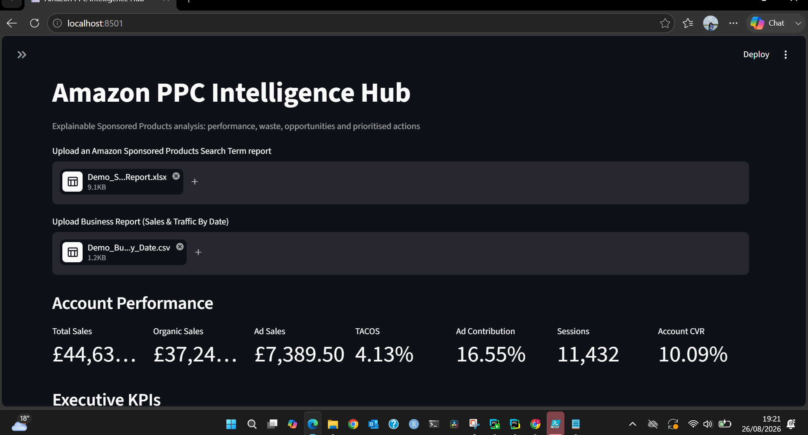
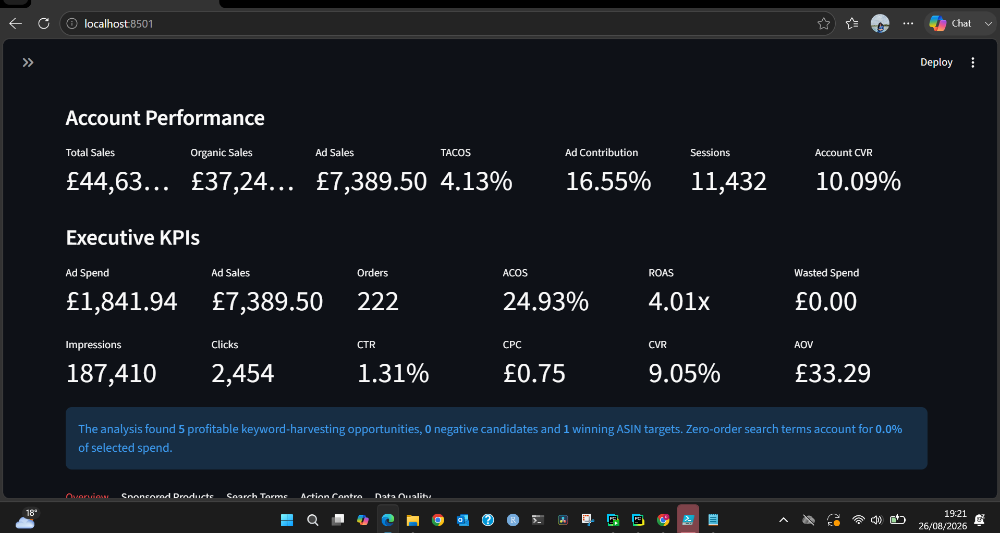

# Amazon PPC Intelligence Hub

An explainable decision-support application for Amazon Sponsored Products advertising. It combines Search Term Report analysis with optional Business Report data to produce account-level KPIs, campaign health classifications, search-term opportunities, prioritised actions and a downloadable Excel report.

## Live demonstration

[](https://devanandha-amazon-ppc-intelligence-hb.streamlit.app)

Try the live application: [Amazon PPC Intelligence Hub](https://devanandha-amazon-ppc-intelligence-hb.streamlit.app)

## Research manuscript and reproducibility

**Current related submission (3 November 2026):** *When Profitable Exploration Does Not Demonstrate Learning: Diagnostics from a Synthetic Sponsored-Search Study*, submitted to *Electronic Commerce Research* (manuscript ID ELEC-D-26-02630). Submission has been confirmed; no acceptance, publication or external peer review is claimed.

**Earlier submission:** *Separating Profitability from Information Value in Sponsored Search Evidence Collection* was submitted to *Operations Research Forum* on 29 October 2026 and declined at editorial screening on 30 October 2026.

The computational study separates the immediate profitability of exploratory traffic from the downstream value of using its observations. In the studied synthetic setting, positive net-probing returns do not establish an additional information-use benefit. The research materials include the original comparisons, post-hoc profitability controls, a fresh-seed information-use intervention, adverse findings and limitations.

[Read the research summary and reproduction instructions](research/bayesian_voi/README.md) · [Protocol](research/bayesian_voi/INFORMATION_USE_PROTOCOL.md) · [Results](research/bayesian_voi/INFORMATION_USE_RESULTS.md)

All research data are synthetic. These experiments are separate from the live application and do not demonstrate real advertising uplift or general algorithmic superiority.

## Independent evaluation

Experienced Amazon Ads practitioners are welcome to review the prototype using fictional data. See the [independent evaluation guide](docs/EXTERNAL_PPC_EVALUATION.md) for a suggested 20–30 minute review and feedback questions.

## Developer branding and AI-assisted review

This independently developed product is branded **Devanandha VS · Applied AI & E-commerce Analytics** and includes a custom HTML/CSS presentation, an author profile and transparent model limitations. The new **AI Review** tab fits an exploratory scikit-learn Isolation Forest to aggregated search-term patterns and reports a 90% Bayesian interval for conversion-rate uncertainty where the binomial approximation is applicable. It compares model flags with existing rule-based actions for *human review*, not automatic changes.

**Important:** The unsupervised outlier flags are not validated predictions of profit, fraud, advertising uplift or future performance. The model is fitted to the currently uploaded dataset. Its peer comparisons are descriptive rather than exact model explanations. The public demo uses fictional data. See [AI method and limitations](docs/ML_REVIEW_METHOD.md).

## Decision Assurance Studio (development feature)

The draft release includes a human-centred **Decision Assurance Studio**: a transparent evidence gate that compares the existing PPC action, experimental Isolation Forest review signal, conversion-rate uncertainty and selected evidence thresholds. It flags high-impact suggestions for manual investigation or more data, without overriding the original action or approving live changes.

A **session-only practitioner review workspace** allows an independent evaluator to record whether an original rule is useful, inappropriate or insufficiently supported and download their responses as a CSV. No training or external validation is inferred from those labels, and they are not stored permanently by the app.

An interactive **ACOS sensitivity map** shows how existing rule labels change when the target ACOS is varied; it does not predict campaign performance. Reviewers can also export a **branded, standalone HTML evidence report** or CSV audit. Both exports include search-term data from the active session: share real-account reports only with explicit permission.

See the [reviewer walkthrough](docs/REVIEWER_SHOWCASE.md), [ML methodology](docs/ML_REVIEW_METHOD.md) and the [innovation roadmap](docs/INNOVATION_ROADMAP.md). These features have not been independently validated or demonstrated real advertising uplift.

## Professional dashboard and safe demo

The app includes a polished responsive interface with a built-in **fictional-data demo**. Turn on **Explore the built-in fictional demo** to evaluate campaign and search-term workflows without uploading a file. A **Scenario Lab** compares how proposed decisions change when the target ACOS changes, while keeping the observed data and other thresholds constant.

The scenario comparison is a deterministic rules sensitivity check — **not** a prediction of changes to sales, spend or profit. It is not evidence of a machine-learning model or validated real-world optimisation performance.

## Key capabilities

* Calculates ACOS, ROAS, CTR, CPC, CVR and AOV from aggregated totals.
* Combines advertising performance with optional Business Report data.
* Calculates total sales, organic sales, ad sales and TACOS.
* Calculates advertising contribution, sessions and account conversion rate.
* Supports campaign and match-type filtering.
* Aggregates repeated customer search terms before evaluating performance.
* Classifies campaigns as Healthy, Monitor, Unhealthy or Insufficient Data.
* Identifies profitable search terms for exact-match keyword harvesting.
* Detects potential negative keywords using configurable evidence thresholds.
* Identifies converting ASINs for product-targeting review.
* Produces campaign, ad-group and search-term recommendations.
* Provides a priority, explanation, estimated bid adjustment and suggested CPC.
* Identifies wasted spend from search terms with clicks but no attributed orders.
* Exports eight professionally structured Excel worksheets.
* Includes data-quality checks and transparent methodology notes.

## Technology stack

* Python
* Streamlit
* Pandas
* NumPy
* Plotly
* OpenPyXL
* XlsxWriter

## Set up in PyCharm

1. Open the project folder in PyCharm.
2. Select a Python interpreter and create a virtual environment.
3. Open the PyCharm terminal.
4. Install the required packages:

```bash
python -m pip install -r requirements.txt
```

5. Start the application:

```bash
python -m streamlit run app.py
```

6. Open the local Streamlit address displayed in the terminal, normally:

```text
http://localhost:8501
```

## Uploading reports

### Sponsored Products Search Term Report

Upload an Amazon Sponsored Products Search Term Report in `.xlsx` or `.xls` format. This is the primary report required by the application.

### Business Report

Optionally upload a Sales and Traffic by Date Business Report in `.csv` format.

When both reports are uploaded, the application calculates:

* Total sales
* Organic sales
* Advertising sales
* TACOS
* Advertising contribution
* Sessions
* Account conversion rate

## Synthetic demonstration data

No employer or confidential business data is included in this repository.

To create a fictional Sponsored Products report, run:

```bash
python create_synthetic_demo.py
```

Then upload the generated synthetic workbook to the application.

All screenshots in this repository were created using fictional demonstration data.

## Expected Search Term Report fields

The application requires:

* Campaign Name
* Ad Group Name
* Targeting
* Match Type
* Customer Search Term
* Impressions
* Clicks
* Spend
* 7 Day Total Sales
* 7 Day Total Orders (#)

It also uses currency, units, portfolio name and start date when available.

## Expected Business Report fields

The optional Business Report requires:

* Ordered Product Sales
* Units Ordered
* Total Order Items
* Sessions - Total

## Recommendation methodology

The application uses configurable target ACOS, click and order thresholds.

It does not treat traffic with zero sales as having 0% ACOS. ACOS is recorded as undefined where there are no attributed sales, and recommendations are based on the available clicks, spend and order evidence.

Recommendations are directional decision support. Relevance, profitability, placement performance, campaign strategy, attribution, budget constraints and seasonality should be reviewed before applying changes to an advertising account.

## Confidentiality

Do not publish employer campaign names, customer search terms, sales, advertising spend, targeting strategies, credentials or downloadable reports without written permission.

For portfolio demonstrations, use synthetic or appropriately anonymised information only.

## Application screenshots

The following screenshots use entirely fictional demonstration data.

### Account overview



### Executive KPI summary



### Campaign performance charts


### Performance over time


### Campaign health summary


### Search-term performance


### Action Centre


## Portfolio value

This project demonstrates:

* Python application development
* Data cleaning and validation
* Advertising and commercial analytics
* KPI development
* Interactive data visualisation
* Explainable decision-support logic
* Business intelligence reporting
* Confidential-data-safe portfolio development

It can support evidence of technical contribution, independent development and applied business analytics. However, the project alone does not guarantee endorsement under any immigration route.

## Disclaimer

This application is an independent portfolio project and is not affiliated with or endorsed by Amazon. Recommendations should be reviewed by a qualified account owner before implementation.
